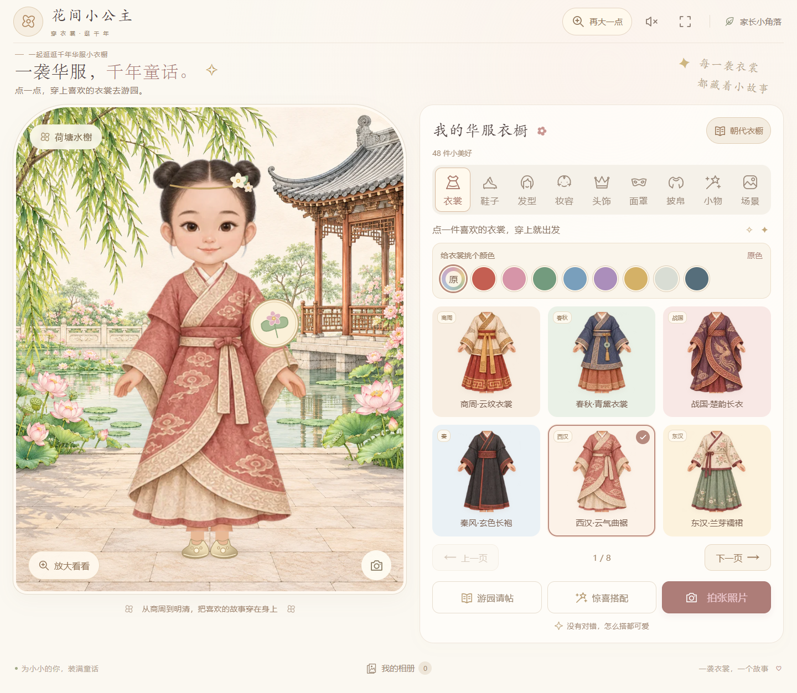

# 花间小公主 · 千年华服衣橱

给 3 岁左右孩子的轻量绘本换装游戏：中国人物、历朝代古风衣裳、大图片，点一点就能自由搭配。原生网页，无需注册或安装。

**[在线玩](https://shelllayer.github.io/petal-princess-wardrobe/)** · **[下载离线版](https://github.com/ShellLayer/petal-princess-wardrobe/releases/latest)** · [使用指南](docs/使用指南.md) · [素材与授权](ASSETS.md)



## 在手机、平板和电脑上玩

用浏览器打开上面的“在线玩”，各设备都使用同一网址，原电脑无需保持开机。也可将网址收藏或添加到主屏幕，方便孩子下次进入。

电脑离线游玩：在 Releases 下载离线压缩包，解压后双击 `花间小公主.html`。文件约 10 MiB，包含全部图片，不需要安装 Node.js。手机文件管理器的 HTML 预览兼容性各异，优先使用在线入口。

搭配、设置和相册保存在当前浏览器，不会自动同步到其他设备；喜欢的装扮可“拍张照片 → 保存图片”后分享。无登录、广告、购买、聊天或分析追踪。

## 小衣橱里有什么

| 衣裳 | 鞋履 | 发型 | 妆容 | 头饰 | 面罩 | 披帛等 | 手持小物 | 场景 |
| ---: | ---: | ---: | ---: | ---: | ---: | ---: | ---: | ---: |
| 48 | 36 | 30 | 16 | 42 | 24 | 30 | 42 | 12 |

共 **280 个选项**，包括素颜、摘下与放下，颜色不重复计数。衣装含 39 套朝代灵感、3 套中国神话和 6 套童话裙装。参考范围从商周、春秋战国、秦汉、三国两晋、南北朝、隋唐五代，到宋辽夏金元和明清；详见 [朝代服饰梳理](docs/v3/朝代服饰梳理.md)。全部为儿童绘本化创作。

- 大卡片点选，每页最多六件；可看头部、鞋子特写和进一步放大。
- 每一类独立选颜色，提供淡妆、花钿和花瓣贴画。
- 惊喜搭配、游园请帖、撤销、拍照，以及最多 12 套的本机相册。
- 家长可调整声音、中文朗读、安静画面和休息提醒。
- 12 幅 1122×1402 独立背景，按需加载；WebP 与 SVG，无 3D、视频、远程字体或运行时 AI。

## 本地开发

开发推荐 Node.js 22+（依赖最低要求 20.9）；自动发布使用 Node.js 22。直接运行源码：

```sh
npm ci
npm start
```

浏览器打开 `http://127.0.0.1:4173`。这是本机开发地址，其他设备请用在线试玩网址。

```sh
npm run build        # 生成单文件「花间小公主.html」
npm run build:site   # 生成可托管的 dist/，只包含运行所需文件
npx playwright install chromium
npm test            # 换装、配色、贴合、照片、相册、离线与移动布局检查
```

提交到 `main` 后，GitHub Actions 构建、检查并发布到 GitHub Pages。首次部署、素材重建与文件说明见 [开发与发布](docs/开发与发布.md)。

## 素材与运行情况

代码与随附原创美术按 **MIT** 许可开放。人物和场景使用 AI 辅助创作，SVG 配件由项目代码绘制；原图、处理脚本和完整提示词均保留。详见 [素材来源与授权](ASSETS.md)。

当前本机检查覆盖 Chrome / Edge、手机与平板尺寸和完全离线游玩；首屏资源采样约 0.62 MiB，单文件离线版约 10 MiB。尚未进行 iOS / Android 实机和真人幼儿试玩，不承诺所有设备性能相同。见 [高清场景与验证](docs/v4.2/高清场景说明与验证.md)。
